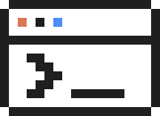
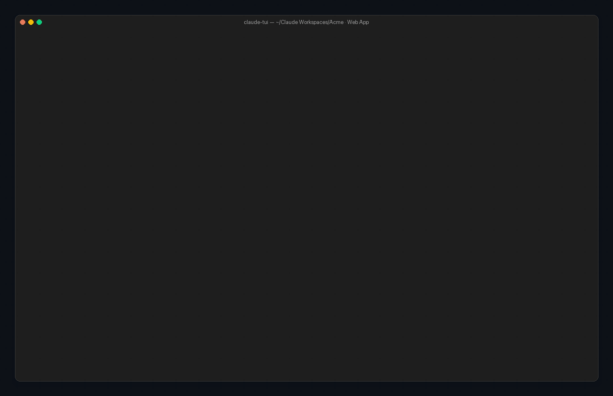

<br/>
<p align="center">
<picture>
  <source media="(prefers-color-scheme: dark)" srcset="./docs/logo-inverse.svg">
  <source media="(prefers-color-scheme: light)" srcset="./docs/logo.svg">
  
</picture>
</p>

<h3 align="center">claude-tui</h3>
<p align="center">A full-screen terminal workspace for coding agents.<br/>Run <b>Claude Code</b>, <b>Codex</b> and <b>Antigravity</b> side by side.</p>

<br/>

<p align="center">
   &nbsp; &nbsp;
</p>
<p align="center">
   &nbsp; &nbsp;<a href="./LICENSE"></a>
</p>

<h1 aria-hidden="true"></h1>

<br/>

<p align="center">
  
</p>

<p align="center"><sub>Three agents working at once: Claude adds a dark mode switch, Codex fixes a flaky test, Antigravity audits a page.<br/>Recorded from the real UI in demo mode; the projects, chats and GitHub activity are made up.</sub></p>

<br/>

## ✨ Features

- **Three agents, one screen.** Every pane runs its own agent: Claude Code (through the Agent SDK, with your settings, CLAUDE.md, hooks and plugins), Codex (`codex app-server`) or Antigravity (`agy`). <kbd>Ctrl</kbd> <kbd>N</kbd> asks which one.
- **Bento grid.** Panes fill the screen in rows of two; an odd one out spans the row. Move a pane up or down, resize the columns together, never scroll sideways.
- **Workspaces sidebar.** Your projects in `~/Claude Workspaces`, with each folder's sessions from all three agents (◦ Claude · ◆ Codex · ▲ Antigravity) and nested subfolders. Click a session to resume it in the right CLI.
- **Usage that follows focus.** Click a pane and the Usage card shows that agent's 5-hour and weekly limits.
- **Permission prompts that stay out of the way.** <kbd>y</kbd> / <kbd>a</kbd> / <kbd>n</kbd> for Claude and Codex approvals; <kbd>Shift</kbd> <kbd>Tab</kbd> changes the mode and the status line updates instantly.
- **A Figma workflow for design engineers.** `claude-tui --workflow figma` opens three linked Claude sessions: one designs with you in Figma, one acts on developers' comments and Dev Mode annotations, one turns finished designs into pull requests. [Set it up](#-figma-workflow).
- **GitHub in reach.** <kbd>Ctrl</kbd> <kbd>T</kbd> opens your GitHub activity, PRs, issues and CI beside the panes; <kbd>Ctrl</kbd> <kbd>G</kbd> drives your real Chrome through Browser MCP.
- **Made for the terminal.** Brand-colored pane tags, pixel agent icons, 32 themes (`/theme`), 20 of them with their own UI style: frames, titles, tags, prompt marker, how your prompts appear, status line, rebindable keys (`/keys`), mouse support and voice typing (<kbd>Ctrl</kbd> <kbd>V</kbd>, macOS speech recognition).

## 📥 Install

### Before you start

- **A Mac with Apple Silicon** (M1 or later). On an Intel Mac, use [From source](#️-from-source) instead.
- **Nothing else to install for claude-tui itself.** No Node, no npm: the download carries its own runtime and the Claude engine.
- **At least one agent you're signed in to.** Claude is the usual starting point (see [step 3](#3-sign-in-to-the-agents-you-want)).

### 1. Run the installer

Open **Terminal** and paste:

```bash
curl -fsSL https://github.com/romeet9/claude-tui/releases/latest/download/install.sh | bash
```

It downloads the latest release, checks its checksum, puts it in `~/.claude-tui` and adds the `claude-tui` command to `~/.local/bin`. At the end it lists which agents it found.

### 2. Open a new Terminal tab

If the installer says it **added `~/.local/bin` to your PATH**, open a new tab (<kbd>⌘</kbd> <kbd>T</kbd>) so the `claude-tui` command is found. Check it:

```bash
claude-tui --version
```

### 3. Sign in to the agents you want

| To use | Do this once |
| --- | --- |
| **Claude** | Built in. Sign in with [Claude Code](https://docs.anthropic.com/en/docs/claude-code) (`claude`, then `/login`), or set `ANTHROPIC_API_KEY` |
| **Codex** | Install the [Codex CLI](https://github.com/openai/codex) (`brew install codex`), then `codex login` |
| **Antigravity** | Install the Antigravity CLI (`agy`) and sign in |
| **GitHub panel** (optional) | Install the [GitHub CLI](https://cli.github.com) (`brew install gh`), then `gh auth login` |

You only need the ones you'll use. Panes for an agent you haven't set up show an error instead of crashing.

### 4. Run it

```bash
cd ~/path/to/your/project
claude-tui
```

Want to look around first? `claude-tui demo` opens a tour with made-up projects and replies; it needs no accounts.

### Update

Run the same install command again. It replaces the old version and keeps your settings (`~/.config/claude-tui`).

### Uninstall

```bash
rm -rf ~/.claude-tui ~/.local/bin/claude-tui
rm -rf ~/.config/claude-tui     # optional: your themes, keys and saved layout
```

### Troubleshooting

| Problem | Fix |
| --- | --- |
| `command not found: claude-tui` | Open a new Terminal tab, or run `export PATH="$HOME/.local/bin:$PATH"` |
| "This release is for Apple Silicon Macs" | You're on an Intel Mac: install [from source](#️-from-source) |
| Claude pane says you're not logged in | Run `claude` once and sign in, or set `ANTHROPIC_API_KEY` |
| Codex / Antigravity pane fails to start | Make sure `codex` / `agy` runs in a normal terminal and is signed in |
| The layout looks wrong after an update | `claude-tui --fresh` starts with a clean layout |

## 🛠️ From source

**Requirements:** macOS, Node 20+, and the agent CLIs you want to use, signed in:
[Claude Code](https://docs.anthropic.com/en/docs/claude-code) · [Codex](https://github.com/openai/codex) · Antigravity (`agy`).
The GitHub panel uses the [GitHub CLI](https://cli.github.com) (`gh auth login`).

```bash
git clone https://github.com/romeet9/claude-tui.git
cd claude-tui
npm install
npm link            # adds the claude-tui command

claude-tui                  # in any project folder
claude-tui --agent codex    # first pane runs Codex (or --agent agy)
claude-tui -c               # continue the last session here
claude-tui --fresh          # ignore the saved layout
```

Try it without any agents or accounts: `npm run demo` opens the UI with made-up projects and scripted replies, in a throwaway home folder.

## 🎨 Figma workflow

For design engineers: one command opens three Claude sessions that work on the same Figma file and hand work to each other.

| Pane | Does |
| --- | --- |
| **Design** (full width) | Designs with you in Figma, round by round: "make 5 versions of the card" → you pick one → "iterate on C3". The pane shows the round, the variants and your pick. |
| **Annotations** | Checks the file for new comments and Dev Mode annotations from developers, makes the changes in Figma and marks each one done. |
| **Publish** | Turns finished designs into code in your project, opens a pull request (never pushes to main) and shows its checks live. |

### Set it up

**1. Sign in to Figma in Claude Code first.** claude-tui can't do the Figma sign-in itself, so do it once in the official Claude Code CLI ([install it](https://docs.anthropic.com/en/docs/claude-code) if you haven't):

```bash
claude plugin install figma@claude-plugins-official     # Figma's official plugin
claude                                                   # start Claude Code, then type:
/mcp                                                     # pick "plugin:figma:figma" → Authenticate
```

A browser window opens; allow access and come back. Check it worked:

```bash
claude mcp list        # shows: plugin:figma:figma … ✔ Connected
```

claude-tui uses this same sign-in, so you only do it once.

**2. Tell the workflow which Figma file to use.** Run it once; it creates its settings file and tells you what to fill in:

```bash
claude-tui --workflow figma
```

Open `~/.config/claude-tui/workflows/figma/config.json` and set your file:

```json
{
  "figmaFile": "https://www.figma.com/design/AbC123xyz/My-App",
  "library": "",
  "designFolder": "",
  "codeFolder": "~/code/my-app",
  "checkEveryMinutes": 15
}
```

| Setting | Meaning |
| --- | --- |
| `figmaFile` | **Required.** Link to the Figma file you design in (copy it from the browser) |
| `library` | Optional. Link or name of the component library to design with; empty = the libraries enabled in the file |
| `codeFolder` | Where Publish writes code and opens pull requests; empty = the folder you run claude-tui in |
| `designFolder` | Folder the Design and Annotations sessions work from; empty = the folder you run claude-tui in |
| `checkEveryMinutes` | How often to look for new comments and annotations |

**3. Optional: let it watch for developers' comments.** Annotations needs a Figma personal access token to see new comments. In Figma: **Settings → Security → Personal access tokens → Generate new token**, with read access to **File content**, **Comments** and **Current user**. Save it in your Mac's Keychain (it asks you to paste it):

```bash
security add-generic-password -s claude-tui-figma -a figma -w
```

Without a token everything else works; the Annotations pane just says comment checks are off.

**4. Optional: pull requests.** Publish uses the [GitHub CLI](https://cli.github.com) (`gh auth login`) in your `codeFolder`, which must be a git repo with a GitHub remote.

**5. Run it.**

```bash
claude-tui --workflow figma            # resumes the three sessions from last time
claude-tui --workflow figma --fresh    # starts three new sessions
```

Talk to the Design pane as you would to Claude. The first comment check only records what's already there, so you're sent only comments that arrive after setup.

> **Figma tools missing in a pane?** Your Figma sign-in expired. Run `claude`, then `/mcp`, and authenticate `plugin:figma:figma` again (step 1).

## ⌨️ Keys

| Keys | Does |
| --- | --- |
| <kbd>Ctrl</kbd> <kbd>N</kbd> | New pane: pick Claude, Codex or Antigravity (<kbd>1</kbd> <kbd>2</kbd> <kbd>3</kbd>) |
| <kbd>Shift</kbd> <kbd>←</kbd> <kbd>→</kbd> <kbd>↑</kbd> <kbd>↓</kbd> | Focus the previous / next pane, or the one above / below |
| <kbd>Ctrl</kbd> <kbd>Y</kbd> / <kbd>Ctrl</kbd> <kbd>D</kbd> | Move the focused pane up / down the grid |
| <kbd>Ctrl</kbd> <kbd>K</kbd> / <kbd>Ctrl</kbd> <kbd>L</kbd> | Narrow / widen the left column (or drag the edge between panes) |
| <kbd>Ctrl</kbd> <kbd>W</kbd> | Focus the sidebar and back |
| <kbd>Ctrl</kbd> <kbd>P</kbd> / <kbd>Ctrl</kbd> <kbd>X</kbd> | Pause / close a pane (it stays resumable from the sidebar) |
| <kbd>Shift</kbd> <kbd>Tab</kbd> | Permission mode: default → accept edits → plan → auto |
| <kbd>Ctrl</kbd> <kbd>T</kbd> / <kbd>Ctrl</kbd> <kbd>G</kbd> | GitHub / browser panel |
| <kbd>Ctrl</kbd> <kbd>E</kbd> | Show every tool call instead of one summary line |
| <kbd>Ctrl</kbd> <kbd>V</kbd> | Voice typing |
| <kbd>/</kbd> | Commands: `/theme` `/model` `/mcp` `/keys` `/font` `/copy` `/new` |

Every shortcut can be changed with `/keys`.

## 🤖 Agents

| | Claude Code | Codex | Antigravity |
| --- | --- | --- | --- |
| Runs through | Agent SDK | `codex app-server` (JSON-RPC) | `agy` print mode, stream-json |
| Permission prompts | ✅ y / a / n | ✅ commands and file changes | ➖ headless agy can't ask; the pane lists what it denied |
| <kbd>Shift</kbd> <kbd>Tab</kbd> modes | ✅ | ✅ mapped to approval policy + sandbox | ✅ mapped to `--mode` |
| `/model` | ✅ | ✅ | ✅ |
| Plan usage card | ✅ | ✅ | ✅ (from `agy /usage`) |
| Resume from the sidebar | ✅ full history | ✅ full history | ✅ (your prompts shown) |
| `/mcp`, cost | ✅ | ➖ | ➖ |

## 📦 Project structure

| Path | What it is |
| --- | --- |
| [`src/app.tsx`](./src/app.tsx) | Root: layout, bento grid, keys, mouse |
| [`src/Chat.tsx`](./src/Chat.tsx) | One pane: transcript, prompt, permission box, status line |
| [`src/backends/`](./src/backends/) | One adapter per agent; all emit the same message stream |
| [`src/Sidebar.tsx`](./src/Sidebar.tsx) | Workspaces tree with every agent's sessions |
| [`src/GitHub.tsx`](./src/GitHub.tsx) | GitHub panel (account or repo: activity, PRs, issues, CI) |
| [`workflows/figma/`](./workflows/figma/) | The Figma workflow (`--workflow figma`) |
| [`src/demo.ts`](./src/demo.ts) | Demo mode: made-up data and scripted replies |
| [`voice/main.swift`](./voice/main.swift) | Speech-to-text helper, compiled on first use |
| [`scripts/record-demo.py`](./scripts/record-demo.py) | Records `docs/demo.gif` from the real UI |

## 📦 Building a release

```bash
scripts/build-release.sh    # release/claude-tui-<version>-macos-arm64.tar.gz + install.sh
gh release create v<version> release/*   # bump the version in package.json first
```

The build bundles the app with esbuild, adds the official Node runtime (checksum-verified) and the prebuilt voice helper.

## 🎬 Re-recording the demo

```bash
pip install pyte pillow     # and ffmpeg
npm run record-demo         # writes docs/demo.gif and docs/screenshot.png
```

The script runs demo mode in a virtual terminal, clicks and types through it, and draws each frame in a macOS window.

## 📝 License

[MIT](./LICENSE). Claude, Codex and Antigravity are trademarks of their owners; claude-tui is an independent project and isn't affiliated with Anthropic, OpenAI or Google.

<h1 aria-hidden="true"></h1>

<p align="center">Built in the terminal, with the agents it runs. 🖥️</p>
